<div align="center">

# Allan Soto - Senior Software Developer, Data Engineer & AI Media Specialist

### Creación de Páginas Web | Sistemas POS & Full-Stack | Optimización SQL Server & MySQL | Automatización Python ETL | Power BI | Producción de Video con IA

[](https://react.dev/)
[](https://nextjs.org/)
[](https://www.typescriptlang.org/)
[](https://tailwindcss.com/)
[](https://nodejs.org/)
[](https://github.com/AllanSoto/-LABORATORIO_OPTIMIZACION_SQL)
[](https://github.com/AllanSoto/Automatizaci-n-de-Procesos)
[](https://github.com/AllanSoto/Generaci-n-Edici-n-de-Video-Profesional-con-IA-Reels-Corporativo-)

<br />

[](https://wa.me/50671006253)
[](https://www.fiverr.com/s/BRqvjqy)
[](https://www.linkedin.com/in/allan-soto-b83850271)
[](mailto:allansotoasesorias@outlook.com)
[](https://github.com/AllanSoto/Porfolio)

<br />

> **+6 Años de Experiencia** | **+140 Proyectos Entregados** | **100% Satisfacción Garantizada**  
> Desarrollo páginas web modernas y landing pages de alta conversión, sistemas POS y plataformas Full-Stack, optimizo bases de datos SQL de alto tráfico, construyo pipelines de automatización en Python, diseño tableros ejecutivos en Power BI y produzco videos dinámicos con IA.

</div>

---

## Índice de Proyectos y Demostraciones en Vivo (Video + Capturas HD)

| # | Proyecto | Categoría | Impacto Clave | Video Demo | Repositorio |
| :---: | :--- | :--- | :--- | :---: | :---: |
| **01** | [**Dashboard Empresarial de Toma de Decisiones**](#proyecto-1---dashboard-empresarial-de-toma-de-decisiones) | `Dashboard Empresarial` | Carga `40s -> 0.8s` \| 100% Tiempo Real | [Ver Video](./public/proyecto_1/video.mp4) | [GitHub](https://github.com/AllanSoto/enterprise-kpi-analytics-dashboard) |
| **02** | [**Sistema de KPIs Operativos (Asignaciones, Gestiones y Recuperaciones)**](#proyecto-2---sistema-de-kpis-operativos-asignaciones-gestiones-y-recuperaciones) | `Sistema de KPIs` | `7 KPIs Clave` \| Automatizado (1 min) | [Ver Video](./public/proyecto_2/video.mp4) | [GitHub](https://github.com/AllanSoto/-LABORATORIO_OPTIMIZACION_SQL) |
| **03** | [**SQL Server & Data Engineering Avanzado**](#proyecto-3---sql-server--data-engineering-avanzado) | `SQL & Data Engineering` | Consultas `45 min -> 1.2s` \| -88% CPU | [Ver SQL](#proyecto-3---sql-server--data-engineering-avanzado) | [GitHub](https://github.com/AllanSoto/-LABORATORIO_OPTIMIZACION_SQL) |
| **04** | [**Automatización de Procesos ETL (Excel -> Python -> SQL)**](#proyecto-4---automatización-de-procesos-etl-excel---python---sql-server) | `Automatización & Python` | `3h / Día` ahorradas \| 0% Errores | [Ver Video](./public/proyecto_4/video.mp4) | [GitHub](https://github.com/AllanSoto/Automatizaci-n-de-Procesos) |
| **05** | [**Desarrollo Web Full-Stack Empresarial**](#proyecto-5---desarrollo-web-full-stack-empresarial) | `Desarrollo Web` | `99.9% Uptime` \| Lighthouse 98/100 | [Ver Video](./public/proyecto_5/video.mp4) | [GitHub](https://github.com/AllanSoto/Desarrollo-Web-Full-Stack-Empresarial) |
| **06** | [**Creación de Páginas Web & Landing Pages de Alta Conversión**](#proyecto-6---creación-de-páginas-web--landing-pages-de-alta-conversión) | `Creación Web` | `100/100 Lighthouse` \| Carga `0.4s` \| +45% Leads | [Ver Video](./public/proyecto_6/Proyecto_6.mp4) | [GitHub](https://github.com/AllanSoto/creaci-n-web-negocios-profesionales-y-startups) |
| **07** | [**Generación & Edición de Video Profesional con IA (Reels & 4K)**](#proyecto-7---generación--edición-de-video-profesional-con-ia-reels--corporativo) | `Edición & Video IA` | `+68% Retención` \| Entrega 24-48h | [Ver Video](./public/proyecto_7/proyecto_7_video.mp4) | [GitHub](https://github.com/AllanSoto/Generaci-n-Edici-n-de-Video-Profesional-con-IA-Reels-Corporativo-) |
| **08** | [**GastroPoint - Sistema POS, KDS de Cocina & Pedidos por Asiento**](#proyecto-8---gastropoint-sistema-pos-kds-de-cocina--pedidos-por-asiento) | `Sistema POS & Web App` | `100% Precisión` por Asiento \| Cuenta en 10s | [Ver Video](./public/proyecto_8/gp_video.mp4) | [GitHub](https://github.com/AllanSoto/GastroPoint) |

---

## Proyecto 1 - Dashboard Empresarial de Toma de Decisiones

**Categoría:** `Dashboard Empresarial` | **Cliente:** Gerencia General y Operaciones Empresariales  
**Tecnologías:** `Next.js` | `Node.js` | `SQL Server` | `Power BI` | `KPIs` | `Stored Procedures`

- **El Desafío:** Grandes volúmenes de información operativa fragmentada en múltiples tablas e informes aislados impidían evaluar el desempeño en tiempo real y tomar decisiones estratégicas oportunamente.
- **La Solución:** Sistema integral de dashboards conectando un backend en Node.js, Stored Procedures optimizados en SQL Server, modelo estrella en Power BI e interfaz web responsiva en Next.js que consolida miles de registros diarios en indicadores clave navegables.
- **Impacto Medible:** **`100% Tiempo Real`** en visibilidad gerencial | Velocidad de carga **`40s -> 0.8s`** | **`+65% Rapidez`** en decisiones basadas en datos.

<div align="center">
  <p>
    <a href="./public/proyecto_1/video.mp4"><b>[ Ver Video Demostración (MP4) - Proyecto 1 ]</b></a>
    &nbsp;&nbsp;|&nbsp;&nbsp;
    <a href="https://github.com/AllanSoto/enterprise-kpi-analytics-dashboard"><b>[ Ver Repositorio en GitHub ]</b></a>
  </p>
  <h3>Vista Principal - Panel Ejecutivo de KPIs (Modo Oscuro)</h3>
  <a href="./public/proyecto_1/video.mp4">
    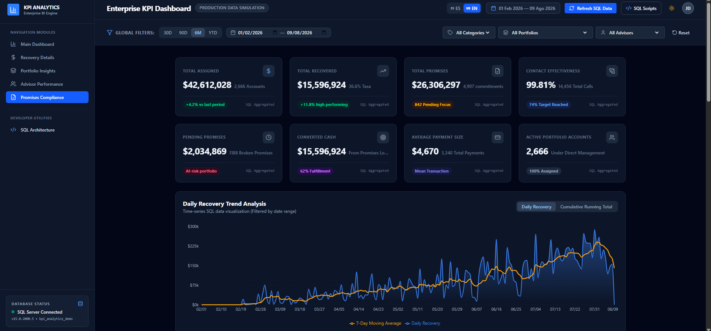
  </a>
</div>

### Galería Completa de Capturas - Proyecto 1

| Panel Principal (Modo Claro / Light Mode) | Desglose por Categoría y Cumplimiento de Pagos |
| :---: | :---: |
| 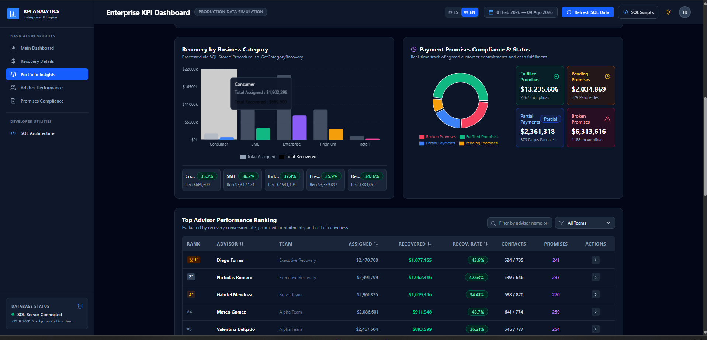 | 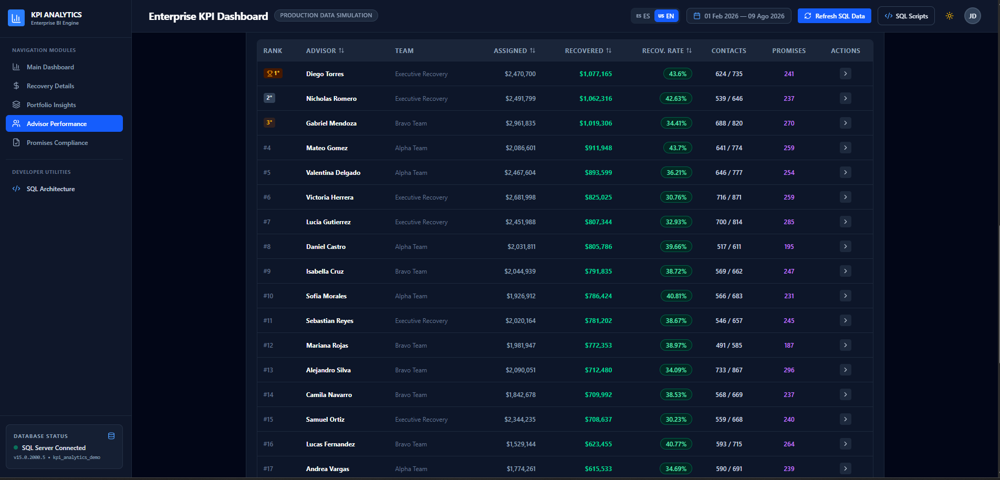 |
| *Interfaz en modo claro con soporte de tema dinámico para alta visibilidad ejecutiva.* | *Gráficos por segmento (Consumer, SME, Enterprise, Retail) y estados de promesas.* |

| Ranking de Rendimiento de Asesores | Canales de Interacción y Actividad Operativa | Filtros Avanzados y Consultas SQL Directas |
| :---: | :---: | :---: |
| 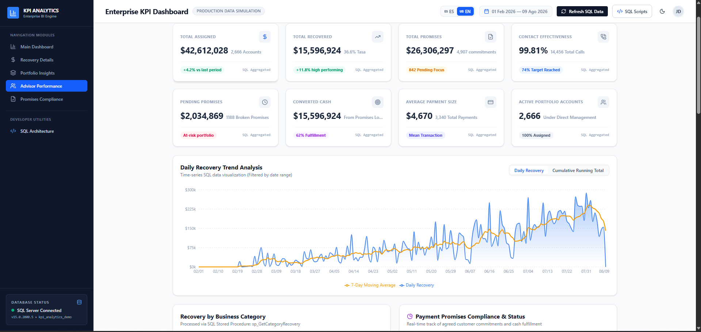 | 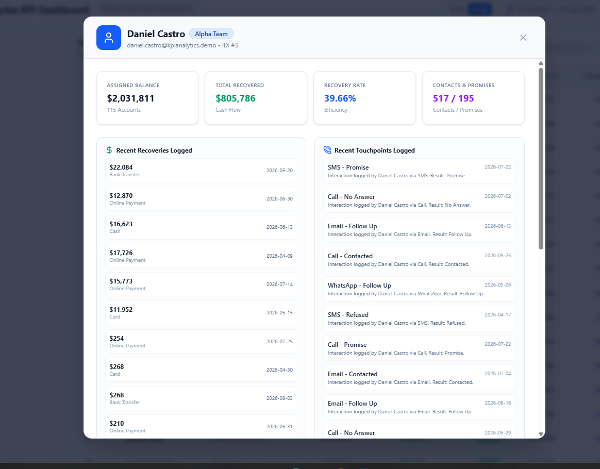 | 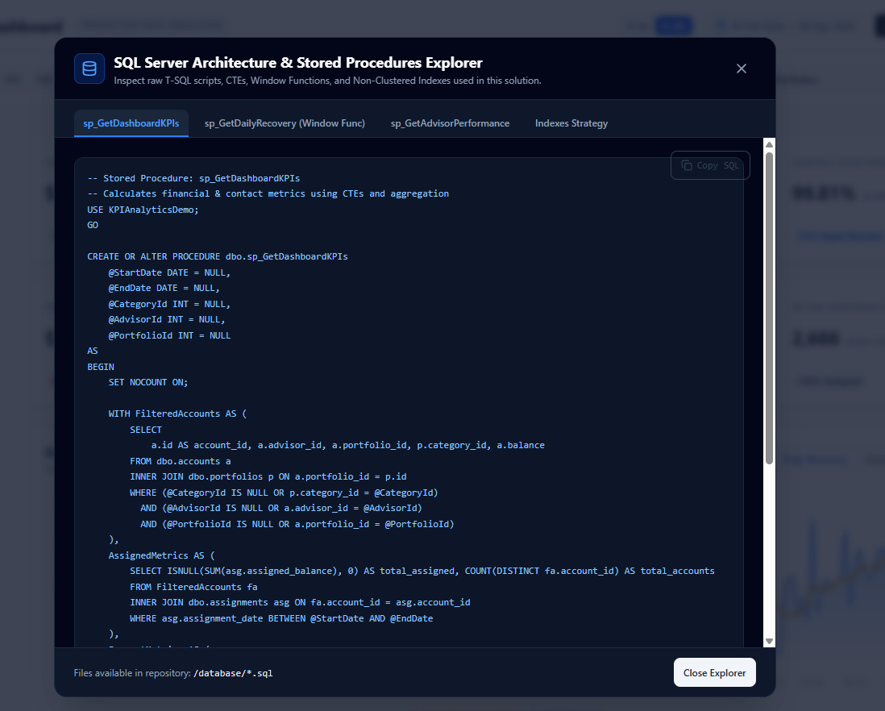 |
| *Tabla interactiva con búsqueda, ordenamiento y porcentajes de recuperación.* | *Distribución de llamadas, WhatsApp, emails y SMS junto al feed en vivo.* | *Filtrado multinivel por período (YTD, MTD, R6M), categorías y carteras.* |

<details>
<summary><b>Ver Código SQL del Proyecto 1 (Stored Procedure de Agregación)</b></summary>

```sql
CREATE PROCEDURE dbo.sp_ObtenerKPIsDashboardEmpresarial
    @FechaInicio DATETIME,
    @FechaFin DATETIME
AS
BEGIN
    SET NOCOUNT ON;
    
    WITH MetricasEstrategicas AS (
        SELECT 
            Categoria,
            COUNT(DISTINCT TransaccionID) AS TotalOperaciones,
            SUM(MontoTotal) AS IngresoGenerado,
            AVG(MontoTotal) AS TicketPromedio
        FROM dbo.VentasEmpresariales WITH (NOLOCK)
        WHERE FechaCalculo BETWEEN @FechaInicio AND @FechaFin
        GROUP BY Categoria
    )
    SELECT 
        Categoria,
        TotalOperaciones,
        IngresoGenerado,
        ROUND(TicketPromedio, 2) AS TicketPromedio,
        DENSE_RANK() OVER(ORDER BY IngresoGenerado DESC) AS RankingCategoria
    FROM MetricasEstrategicas;
END;
```
</details>

---

## Proyecto 2 - Sistema de KPIs Operativos (Asignaciones, Gestiones y Recuperaciones)

**Categoría:** `Sistema de KPIs` | **Cliente:** Área de Cobranzas, Finanzas y Control de Cartera  
**Tecnologías:** `SQL Server` | `T-SQL` | `Stored Procedures` | `Tablas Temporales` | `Index Tuning`

- **El Desafío:** Falta de estandarización en la medición del rendimiento operativo; se requería procesar asignaciones, gestiones, recuperaciones, promesas, contactos efectivos y evaluación por asesor de forma automatizada.
- **La Solución:** Modelo relacional en SQL Server con tablas staging, procesos automatizados mediante Stored Procedures y triggers de auditoría que calculan instantáneamente KPIs Diarios, Acumulados, Mensuales, por Categoría y por Asesor.
- **Impacto Medible:** **`7 Indicadores Clave`** en vivo | Actualización **`Automatizada (1 Min)`** | **`100% Auditado`**.

| KPI / Indicador | KPI Diario | KPI Acumulado | KPI Mensual | Por Categoría | Por Asesor | Rendimiento |
| :--- | :---: | :---: | :---: | :--- | :---: | :---: |
| **Asignaciones** | `1,420 Casos` | `34,200 Casos` | `45,000 Casos` | VIP: 40% \| Estándar: 60% | 142 Casos / Asesor | **Óptimo (98.4%)** |
| **Gestiones Realizadas** | `890 Gestiones` | `21,500 Gestiones` | `28,000 Gestiones` | Llamadas: 70% \| Digital: 30% | 89 Gestiones / Asesor | **Alto (94.2%)** |
| **Recuperaciones ($)** | `$45,200 USD` | `$1,120,000 USD` | `$1,450,000 USD` | Cartera A: 65% \| Cartera B: 35% | $4,520 USD / Asesor | **Excede Meta (105.8%)** |
| **Promesas de Pago** | `64 Promesas` | `1,520 Promesas` | `1,980 Promesas` | Corto Plazo: 80% \| Largo: 20% | 6.4 Promesas / Asesor | **Estable (88.5%)** |
| **Contactos Efectivos** | `410 Contactos` | `9,840 Contactos` | `12,900 Contactos` | Titular: 85% \| Tercero: 15% | 41 Contactos / Asesor | **Superior (46.1%)** |

<div align="center">
  <p>
    <a href="./public/proyecto_2/video.mp4"><b>[ Ver Video Demostración (MP4) - Proyecto 2 ]</b></a>
    &nbsp;&nbsp;|&nbsp;&nbsp;
    <a href="https://github.com/AllanSoto/-LABORATORIO_OPTIMIZACION_SQL"><b>[ Ver Repositorio en GitHub ]</b></a>
  </p>
  <h3>Vista Principal - Panel Ejecutivo de KPIs &amp; Visión Global</h3>
  <a href="./public/proyecto_2/video.mp4">
    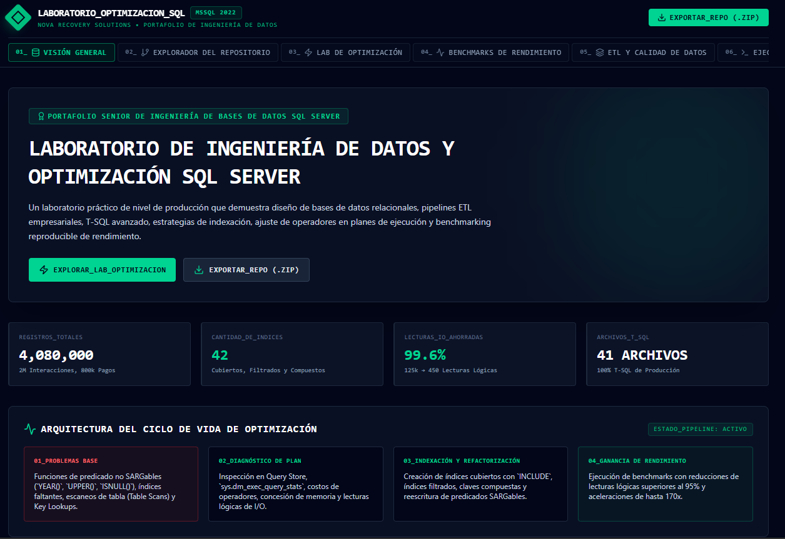
  </a>
</div>

### Galería Completa de Capturas - Proyecto 2

| Control Diario vs. Acumulado y Mensual | Seguimiento de Promesas de Pago & Efectividad |
| :---: | :---: |
| 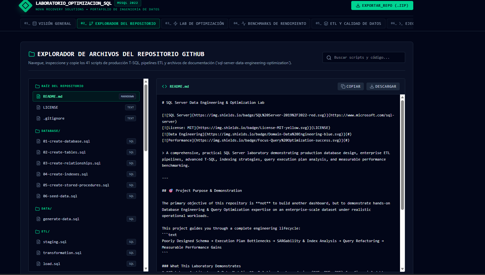 | 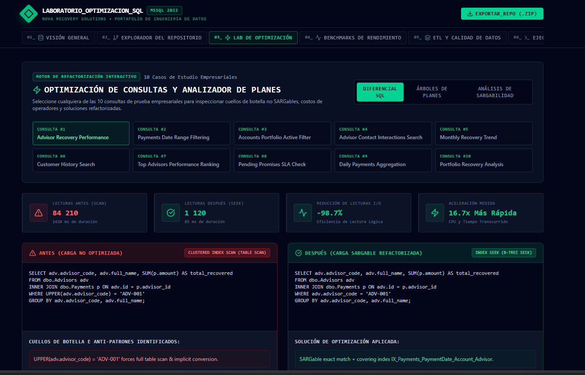 |
| *Monitoreo en tiempo real del progreso diario frente a metas acumuladas y mensuales.* | *Auditoría de promesas a corto y largo plazo con tasas de efectividad.* |

| Rendimiento y Evaluación por Asesor | Segmentación de Cartera por Categorías | Filtros Interactivos y Consultas Consolidadas |
| :---: | :---: | :---: |
| 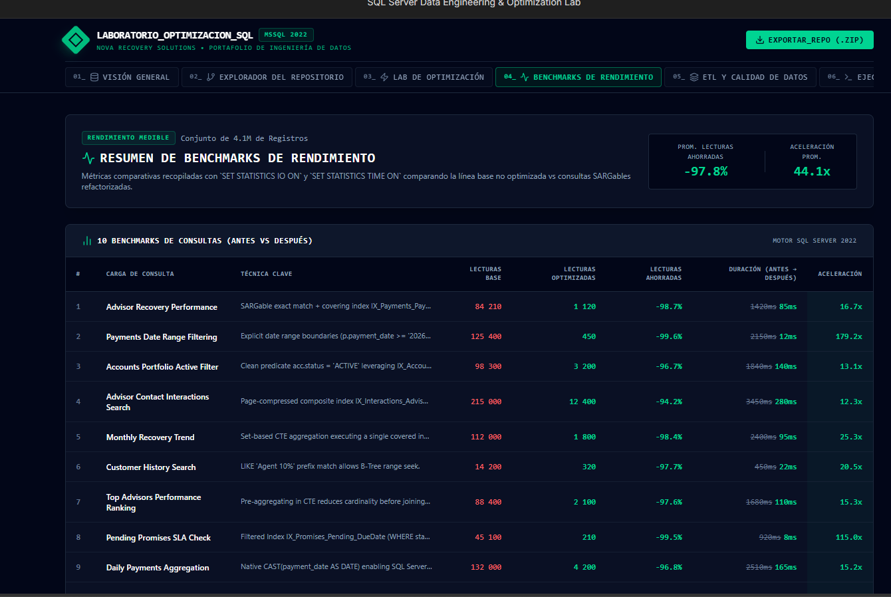 | 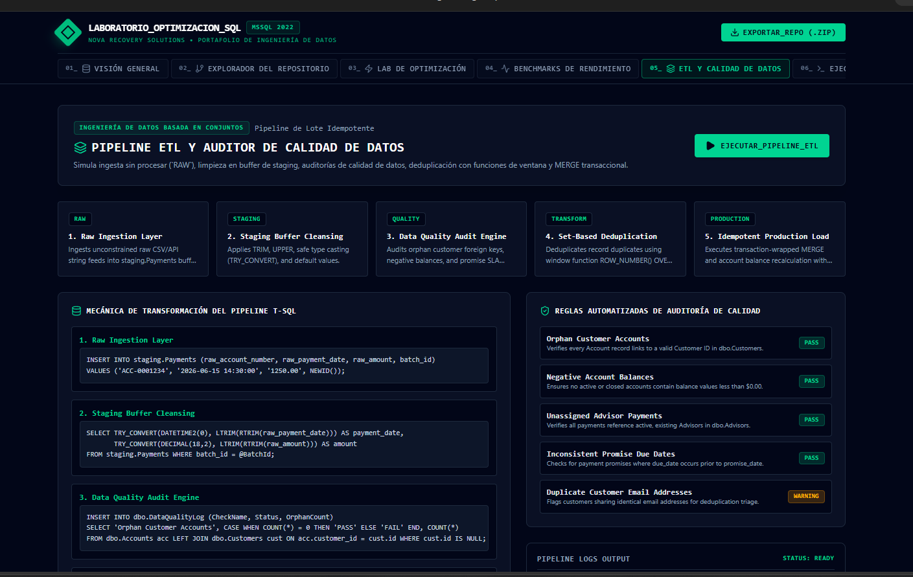 | 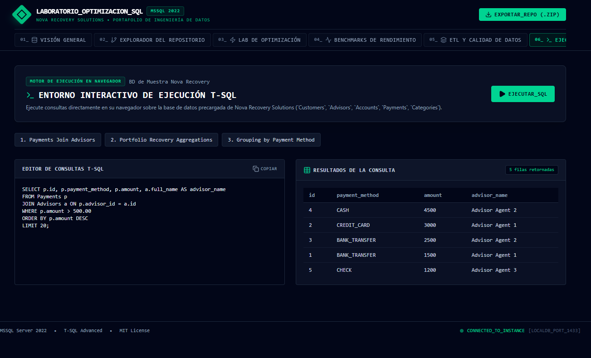 |
| *Evaluación individual por asesor con clasificación automática de metas.* | *Distribución analítica por segmento de cliente y carteras prioritarias.* | *Filtrado dinámico por fechas, asesores y carteras respaldado por SQL Server.* |

---

## Proyecto 3 - SQL Server & Data Engineering Avanzado

**Categoría:** `SQL & Data Engineering` | **Cliente:** Empresa Financiera & Bases de Datos Empresariales  
**Tecnologías:** `SQL Server` | `T-SQL` | `CTEs` | `Window Functions` | `Stored Procedures` | `Índices Compuestos` | `Tablas Temporales #Temp` | `MERGE (UPSERT)`

- **El Desafío:** Procesos de base de datos obsoletos con subconsultas pesadas, falta de tablas temporales indexadas, lecturas bloqueantes y ausencia de índices compuestos que provocaban caídas del servidor en horas pico.
- **La Solución:** Reingeniería completa en T-SQL implementando CTEs modulares, funciones de ventana (`ROW_NUMBER`, `LAG`, `LEAD`, `SUM OVER`), tablas temporales `#Temp` con índices dedicados, operaciones atómicas `MERGE` y afinación profunda de Execution Plans.
- **Impacto Medible:** Tiempo de consulta **`45 min -> 1.2 seg`** | **`-88% Carga de CPU`** | Capacidad verificada para **`+10 Millones de Registros`**.

<div align="center">
  <p>
    <a href="https://github.com/AllanSoto/-LABORATORIO_OPTIMIZACION_SQL"><b>[ Ver Repositorio en GitHub - Laboratorio de Optimización SQL ]</b></a>
  </p>
</div>

```sql
-- Patrón T-SQL Avanzado: CTEs + Window Functions + Tablas Temporales + Tuning
CREATE TABLE #ResumenTemporal (
    ClienteID INT PRIMARY KEY,
    UltimoMonto DECIMAL(18,2),
    MontoAcumulado DECIMAL(18,2),
    FechaUltimoPago DATETIME
);

INSERT INTO #ResumenTemporal (ClienteID, UltimoMonto, MontoAcumulado, FechaUltimoPago)
WITH PagosOrdenados AS (
    SELECT 
        ClienteID,
        Monto,
        Fecha,
        ROW_NUMBER() OVER (PARTITION BY ClienteID ORDER BY Fecha DESC) AS Secuencia,
        SUM(Monto) OVER (PARTITION BY ClienteID) AS TotalCliente
    FROM dbo.Transacciones WITH (NOLOCK)
    WHERE Fecha >= DATEADD(YEAR, -1, GETDATE())
)
SELECT ClienteID, Monto, TotalCliente, Fecha
FROM PagosOrdenados
WHERE Secuencia = 1;

DROP TABLE #ResumenTemporal;
```

---

## Proyecto 4 - Automatización de Procesos ETL (Excel -> Python -> SQL Server)

**Categoría:** `Automatización & Python` | **Cliente:** Empresas con Procesos Manuales y Operaciones Excel  
**Tecnologías:** `Python` | `Pandas` | `OpenPyXL` | `SQL Server` | `MySQL` | `Carga Masiva UPSERT` | `Reportes Automáticos`

- **El Desafío:** El personal operativo invertía más de 3 horas diarias descargando, consolidando y limpiando manualmente múltiples archivos Excel y CSV de distintos formatos para cargarlos en la base de datos corporativa.
- **La Solución:** Pipeline automatizado en Python con Pandas y OpenPyXL que escanea directorios automáticamente, valida esquemas, normaliza montos y fechas, filtra duplicados, ejecuta cargas masivas transaccionales (`MERGE / UPSERT`) en SQL Server / MySQL y emite bitácoras de auditoría sin intervención humana.
- **Impacto Medible:** **`3 Horas / Día`** ahorradas | **`0% Errores Manuales`** | Velocidad de **`50,000 Registros / 15 seg`**.

<div align="center">
  <p>
    <a href="./public/proyecto_4/video.mp4"><b>[ Ver Video Demostración (MP4) - Proyecto 4 ]</b></a>
    &nbsp;&nbsp;|&nbsp;&nbsp;
    <a href="https://github.com/AllanSoto/Automatizaci-n-de-Procesos"><b>[ Ver Repositorio en GitHub ]</b></a>
  </p>
  <h3>Vista Principal - Panel de Automatización &amp; Flujo ETL</h3>
  <a href="./public/proyecto_4/video.mp4">
    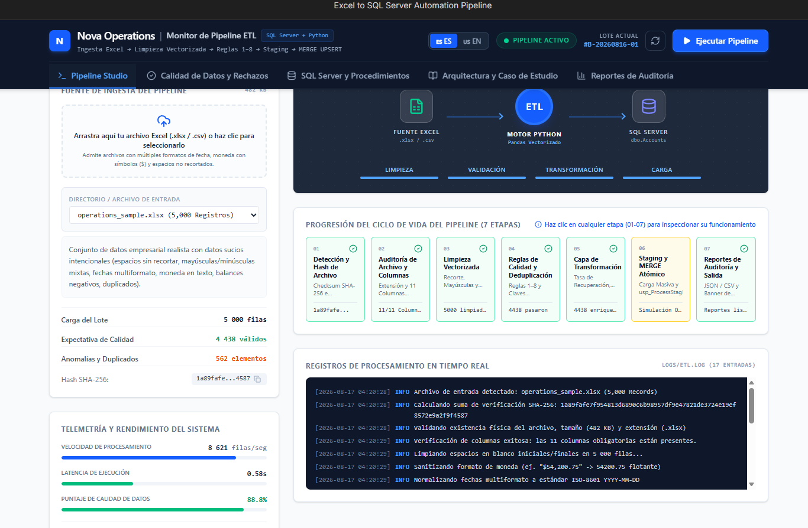
  </a>
</div>

### Galería Completa de Capturas - Proyecto 4

| Lectura y Procesamiento de Archivos Excel / CSV | Módulo de Transformación y Limpieza con Pandas |
| :---: | :---: |
| 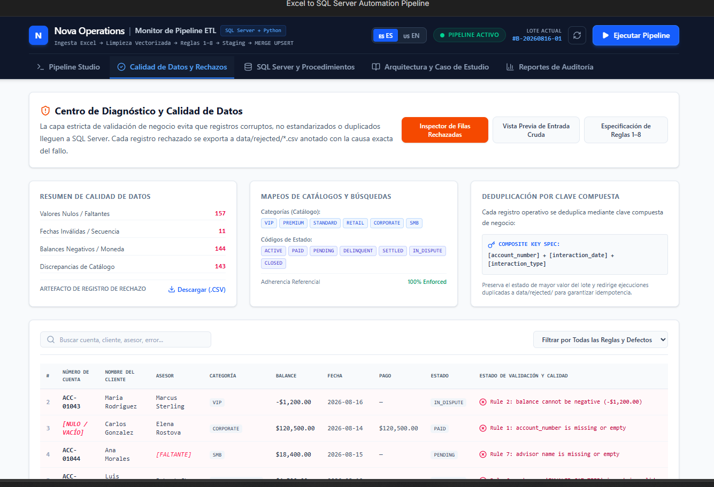 | 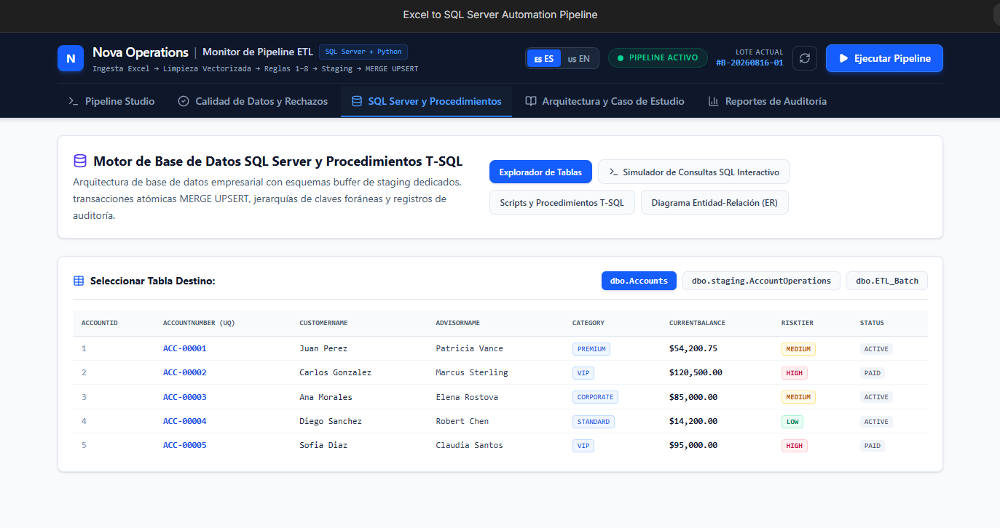 |
| *Inspección automatizada de archivos de entrada para limpieza de nulos y tipos.* | *Normalización de montos, formateo de fechas y filtrado de registros duplicados.* |

| Carga Masiva Transaccional (UPSERT) en Base de Datos | Reportes de Ejecución y Notificaciones de Éxito |
| :---: | :---: |
| 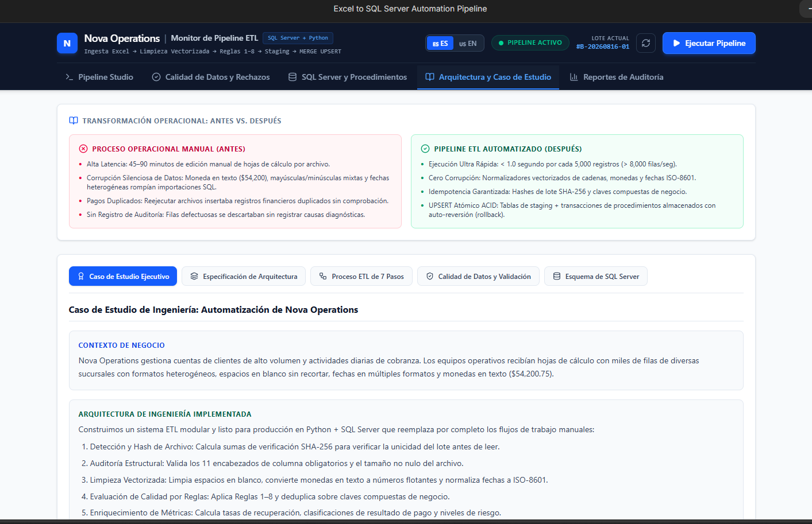 | 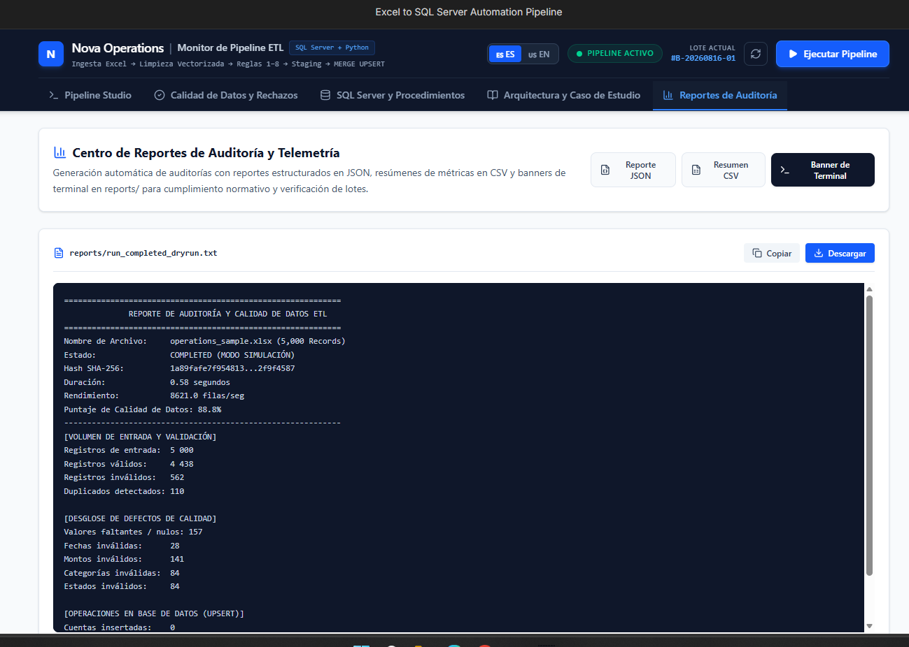 |
| *Inserción y actualización en lote hacia SQL Server / MySQL sin bloqueos.* | *Bitácoras automáticas de ejecución, resumen de registros y alertas.* |

---

## Proyecto 5 - Desarrollo Web Full-Stack Empresarial

**Categoría:** `Desarrollo Web` | **Cliente:** Empresas B2B, SaaS y Sistemas Administrativos  
**Tecnologías:** `React` | `Next.js` | `TypeScript` | `Node.js` | `APIs REST` | `SQL Server` | `MySQL` | `Tailwind CSS` | `Nginx` | `PM2` | `SSL/TLS`

- **El Desafío:** Necesidad de una plataforma web empresarial moderna, segura y de alta disponibilidad que integrara panel de control en tiempo real, control de acceso por roles y conexión robusta a bases de datos relacionales.
- **La Solución:** Arquitectura Full-Stack con React, Next.js, TypeScript y Node.js Express, autenticación JWT, pool de conexiones SQL, despliegue en producción mediante PM2 Cluster Mode, proxy inverso Nginx con certificados SSL activos y hardening de seguridad bajo estándares ISO 27001.
- **Impacto Medible:** **`99.9% Uptime`** | **`98 / 100`** en Lighthouse | Ciberseguridad **`Grado A+`**.

<div align="center">
  <p>
    <a href="./public/proyecto_5/video.mp4"><b>[ Ver Video Demostración (MP4) - Proyecto 5 ]</b></a>
    &nbsp;&nbsp;|&nbsp;&nbsp;
    <a href="https://github.com/AllanSoto/Desarrollo-Web-Full-Stack-Empresarial"><b>[ Ver Repositorio en GitHub ]</b></a>
  </p>
  <h3>Vista Principal - Panel de la Aplicación (Frontend React / Next.js)</h3>
  <a href="./public/proyecto_5/video.mp4">
    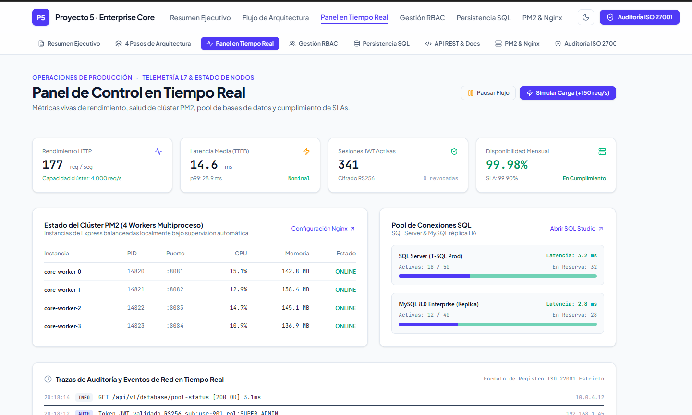
  </a>
</div>

### Galería Completa de Capturas - Proyecto 5

| Gestión de Procesos en Producción con PM2 Cluster Mode | Certificado SSL, Seguridad Web HTTPS & Despliegue Nginx |
| :---: | :---: |
| 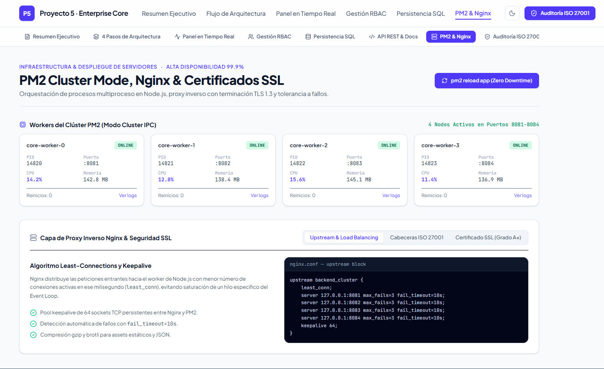 | 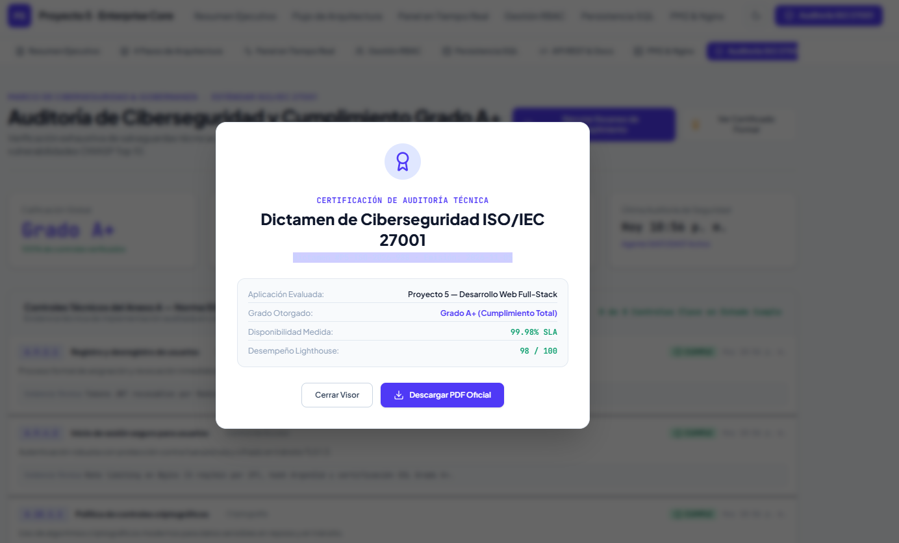 |
| *Servidor Node.js orquestado con PM2 para alta disponibilidad 24/7 sin caídas.* | *Validación de cifrado HTTPS activo, certificado SSL y proxy inverso endurecido.* |

---

## Proyecto 6 - Creación de Páginas Web & Landing Pages de Alta Conversión

**Categoría:** `Creación Web` | **Cliente:** Negocios, Profesionales y Startups  
**Tecnologías:** `Next.js` | `React` | `Tailwind CSS` | `TypeScript` | `Diseño UX/UI` | `SEO On-Page` | `WhatsApp API` | `Google Analytics 4`

- **El Desafío:** Renovar la presencia digital con un sitio web moderno, ultra veloz y optimizado para dispositivos móviles que transformara el tráfico de Google y campañas en clientes reales vía WhatsApp y formularios directos.
- **La Solución:** Arquitectura frontend modular en Next.js/React con tokens semánticos en Tailwind CSS, optimización de imágenes WebP con carga sub-segundo (`0.4s`), contraste accesible auditado WCAG AA e integración directa de embudos de conversión a WhatsApp y eventos `generate_lead` en GA4.
- **Impacto Medible:** Puntuación **`100 / 100`** en Google Lighthouse | Tiempo de carga **`0.4 seg`** | **`+45% Conversión de Leads`**.

<div align="center">
  <p>
    <a href="./public/proyecto_6/Proyecto_6.mp4"><b>[ Ver Video Demostración (MP4) - Proyecto 6 ]</b></a>
    &nbsp;&nbsp;|&nbsp;&nbsp;
    <a href="https://github.com/AllanSoto/creaci-n-web-negocios-profesionales-y-startups"><b>[ Ver Repositorio en GitHub ]</b></a>
  </p>
  <h3>Vista Principal - Hero de Alta Conversión &amp; Métricas Lighthouse 100/100</h3>
  <a href="./public/proyecto_6/Proyecto_6.mp4">
    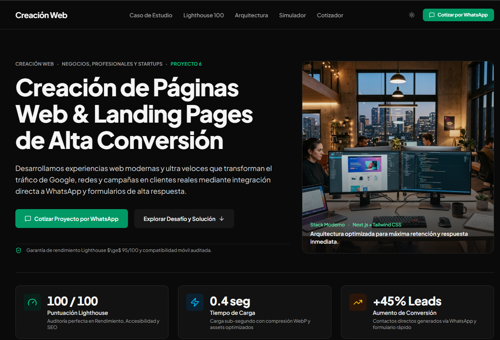
  </a>
</div>

### Galería Completa de Capturas - Proyecto 6

| Paso 01: Diseño UI/UX Centrado en Conversión & Tokens Tailwind | Paso 02: Desarrollo Frontend Modular con Next.js & TypeScript |
| :---: | :---: |
| 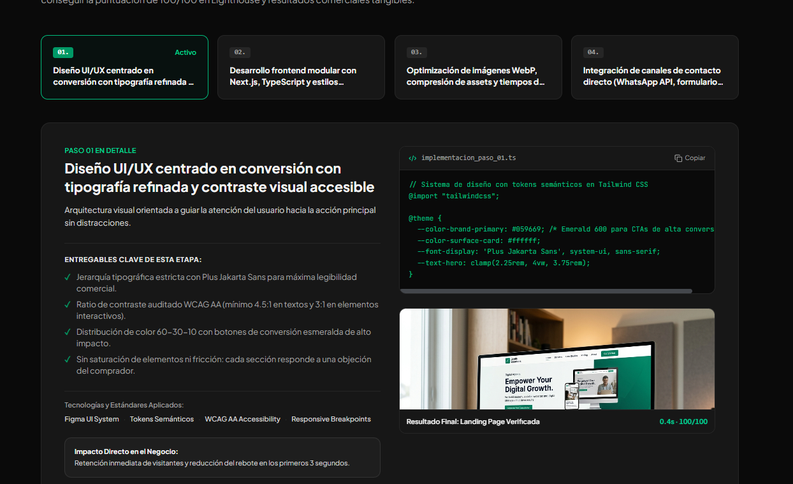 | 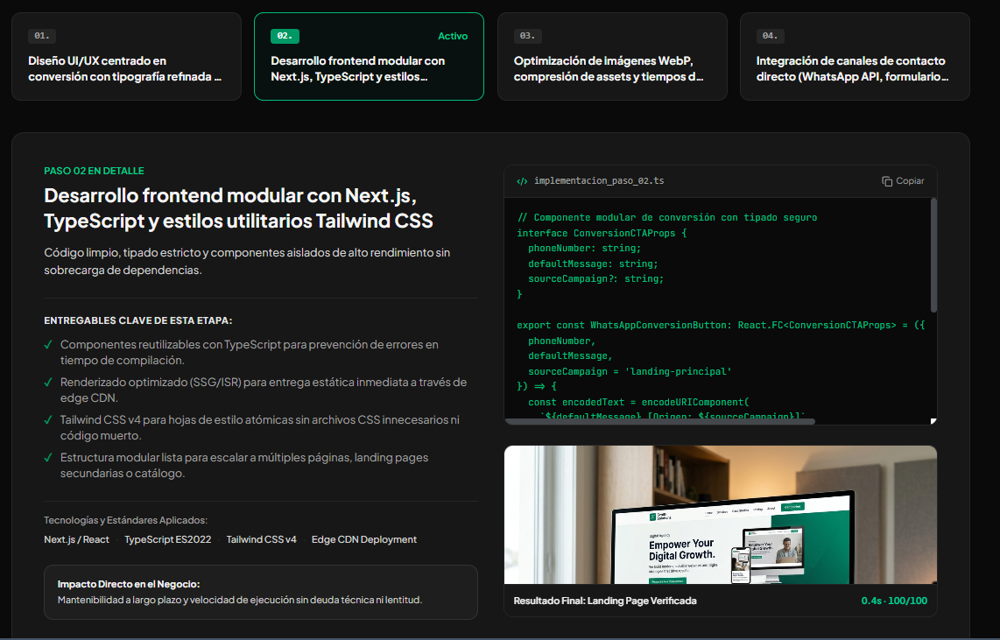 |
| *Jerarquía tipográfica Plus Jakarta Sans, contraste WCAG AA y tokens semánticos.* | *Componentes reutilizables con tipado estricto, SSG/ISR y botón modular de WhatsApp.* |

| Paso 03: Optimización de Imágenes WebP & Carga 0.4s | Paso 04: Integración de WhatsApp API, Formularios & GA4 |
| :---: | :---: |
| 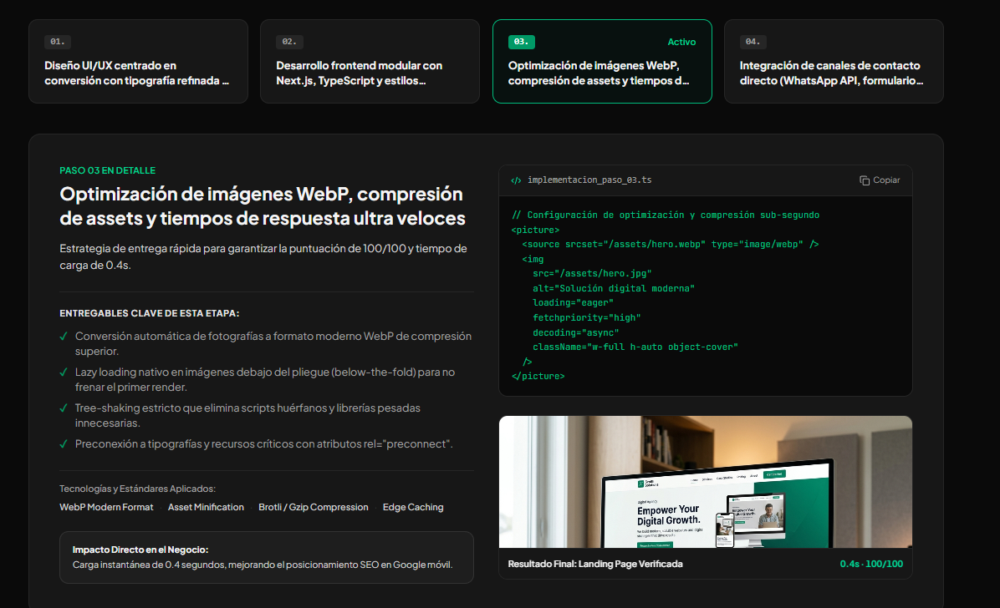 | 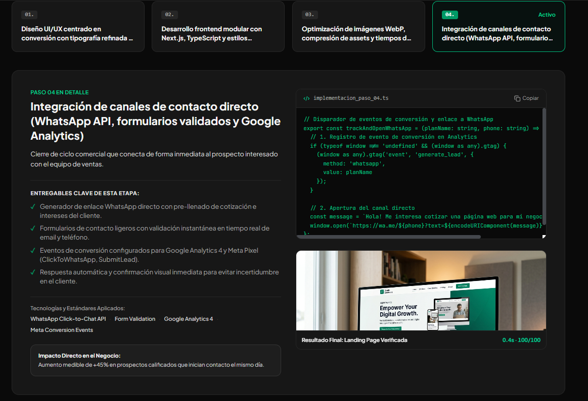 |
| *Entrega en formato WebP, lazy loading nativo, tree-shaking y preconexión.* | *Disparo de eventos de conversión en Google Analytics 4 y apertura de WhatsApp.* |

---

## Proyecto 7 - Generación & Edición de Video Profesional con IA (Reels & Corporativo)

**Categoría:** `Edición & Video IA` | **Cliente:** Marcas Personales, Creadores de Contenido y Empresas  
**Tecnologías:** `Runway Gen-3 Alpha Turbo` | `Midjourney v6.1` | `Pika 2.0` | `ElevenLabs Multilingual v2` | `Premiere Pro` | `CapCut Pro` | `After Effects`

- **El Desafío:** Producir contenido audiovisual hiperdinámico y constante para redes sociales (`9:16 Reels / TikTok / Shorts`) y videos corporativos (`16:9 Cinema 4K`) sin costos de rodaje físico desorbitados y con máxima retención en los primeros 3 segundos.
- **La Solución:** Pipeline audiovisual integral que fusiona estructuración de guiones con gancho (`Hook 0-3s`), generación de escenas y B-rolls con IA (`Runway Gen-3`, `Midjourney`, `Pika`), locución neural ultra natural o limpieza quirúrgica de voz (`ElevenLabs` a `-14.0 LUFS`) y postproducción multipista con subtítulos animados palabra por palabra, LUT cinematográfico Kodak 2383 y diseño sonoro (`SFX`).
- **Impacto Medible:** **`+68% Visualización y Retención`** | Tiempo de entrega **`24 - 48 Horas`** | Formatos **`9:16 Reels & 16:9 4K`**.

<div align="center">
  <p>
    <a href="./public/proyecto_7/proyecto_7_video.mp4"><b>[ Ver Video Demostración (MP4) - Proyecto 7 ]</b></a>
    &nbsp;&nbsp;|&nbsp;&nbsp;
    <a href="https://github.com/AllanSoto/Generaci-n-Edici-n-de-Video-Profesional-con-IA-Reels-Corporativo-"><b>[ Ver Repositorio en GitHub ]</b></a>
  </p>
  <h3>Vista Principal - Resumen Ejecutivo &amp; Monitor Master IA (9:16 Reels &amp; 16:9 4K)</h3>
  <a href="./public/proyecto_7/proyecto_7_video.mp4">
    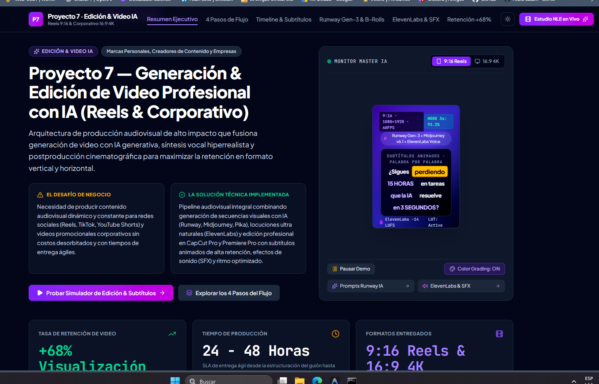
  </a>
</div>

### Galería Completa de Capturas - Proyecto 7

| Timeline Multipista (Premiere / CapCut / AE) & Controles en Tiempo Real | Flujo de 4 Pasos & Estructurador de Guión y Gancho (Hook 0-3s) |
| :---: | :---: |
| 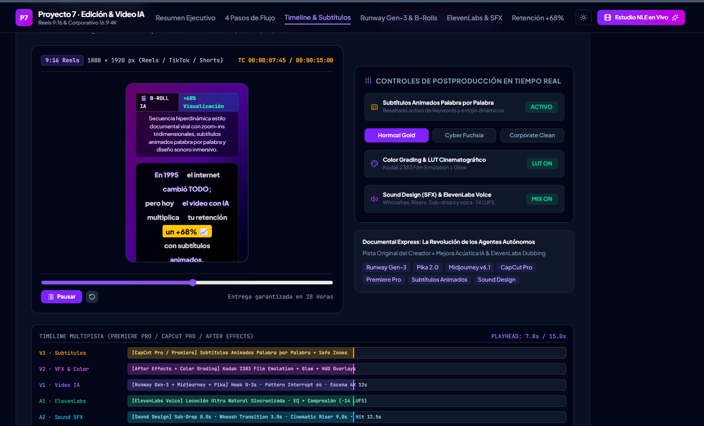 | 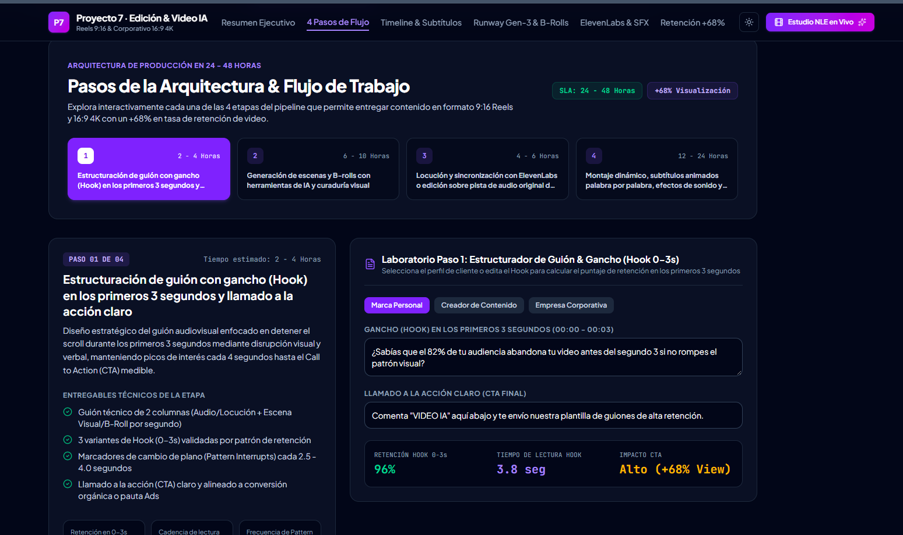 |
| *Subtítulos animados palabra por palabra, LUT Kodak 2383 y pistas V1-V3 / A1-A2.* | *Laboratorio de Hooks (0-3s) con 96% de retención y marcadores de Pattern Interrupt.* |

| Laboratorio de Escenas IA & Curaduría B-Roll (Runway Gen-3 & Midjourney) | Estudio de Locución Ultra Natural (ElevenLabs v2) & Sound Design (SFX) |
| :---: | :---: |
| 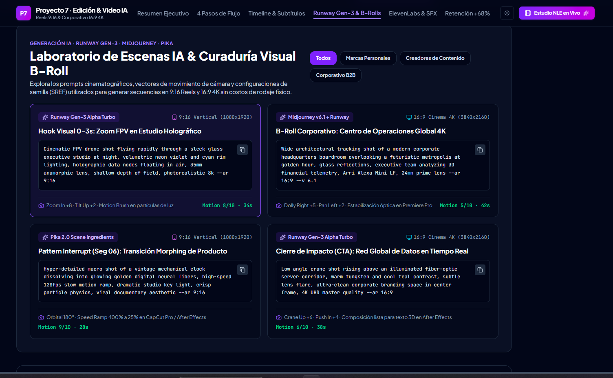 | 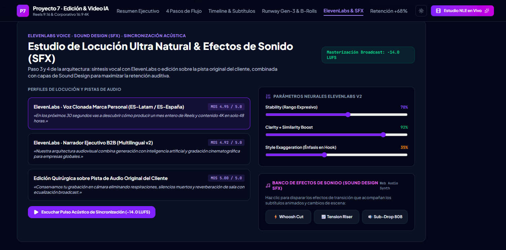 |
| *Prompts cinematográficos, control de cámara (FPV Zoom, Dolly) en 9:16 y 16:9 4K.* | *Síntesis vocal neural, masterización broadcast a -14.0 LUFS y banco de efectos SFX.* |

---

## Proyecto 8 - GastroPoint: Sistema POS, KDS de Cocina & Pedidos por Asiento

**Categoría:** `Sistema POS & Web App` | **Cliente:** Restaurantes Gourmet, Cafeterías de Especialidad y Franquicias Gastronómicas  
**Tecnologías:** `React` | `Next.js` | `TypeScript` | `Tailwind CSS` | `Node.js` | `Kitchen Display System (KDS)` | `Motor de Facturación Dividida`

- **El Desafío:** En restaurantes y cafeterías de alta rotación, las órdenes grupales causaban confusión al entregar platillos en el asiento equivocado, demoras en la comunicación con cocina y cuellos de botella al momento de dividir o unificar la factura entre varios comensales.
- **La Solución:** Desarrollé **GastroPoint**, una plataforma gastronómica integral donde cada comensal o mesero selecciona la modalidad (`Restaurante` / `Cafetería`), la mesa por zona (`Terraza`, `Ventana`, `Salón Principal`, `Zona VIP`, `Barra Espresso`) y el **número exacto de su asiento (`Posición #1, #2, #3, #4...`)**. Las comandas llegan en vivo al **Monitor de Cocina (KDS)** detallando mesa, asiento y notas de preparación, mientras el módulo de cierre permite **facturar toda la mesa junta, cobrar por posición individual, unir asientos específicos o dividir en partes iguales**.
- **Impacto Medible:** **`100% Precisión`** en entrega por asiento | División y cierre de cuenta de **`5 min -> 10 seg`** | Sincronización Salón-Cocina en **`Tiempo Real`**.

<div align="center">
  <p>
    <a href="./public/proyecto_8/gp_video.mp4"><b>[ Ver Video Demostración (MP4) - Proyecto 8 ]</b></a>
    &nbsp;&nbsp;|&nbsp;&nbsp;
    <a href="https://github.com/AllanSoto/GastroPoint"><b>[ Ver Repositorio en GitHub ]</b></a>
  </p>
  <h3>Vista Principal - Registro en Mesa, Selección de Modalidad y Asiento Exacto</h3>
  <a href="./public/proyecto_8/gp_video.mp4">
    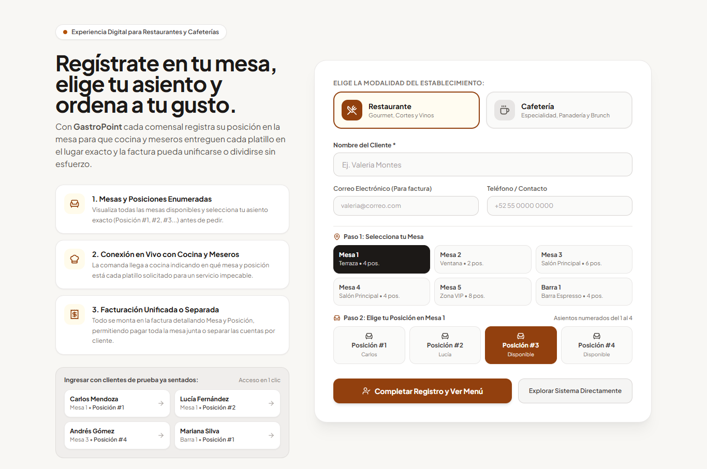
  </a>
</div>

### Galería Completa de Capturas - Proyecto 8 (GastroPoint)

| Mapa de Mesas por Zonas y Vista Radial de Asientos | Menú Digital Gastronómico con Asignación por Posición |
| :---: | :---: |
| 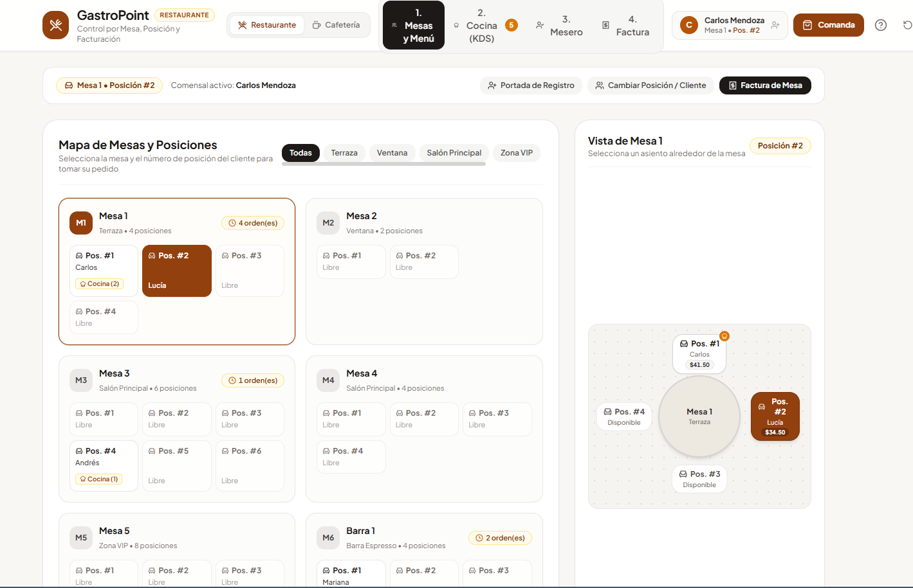 | 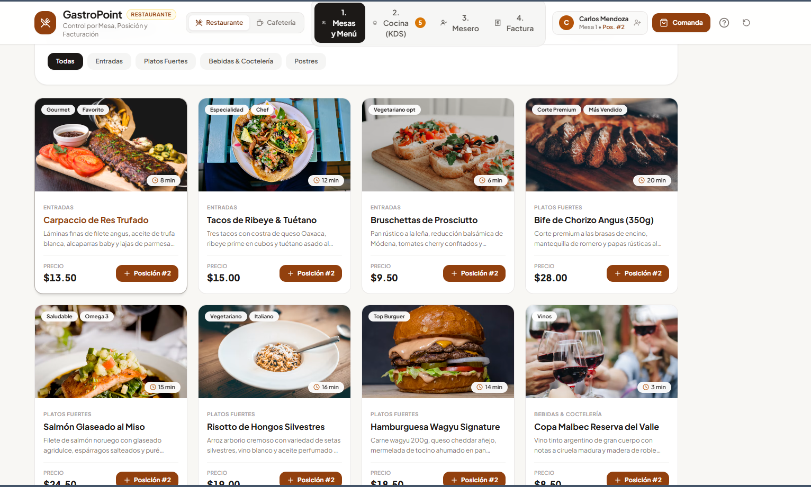 |
| *Mapa interactivo por zonas y diagrama radial con el consumo individual por asiento.* | *Catálogo de entradas, platos fuertes, bebidas y postres asignados directo a la posición.* |

| Monitor de Cocina (KDS) con Comandas por Mesa y Asiento | Control de Salón y Servicio Operativo de Meseros |
| :---: | :---: |
| 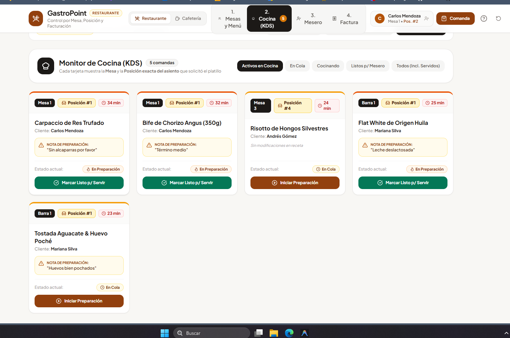 | 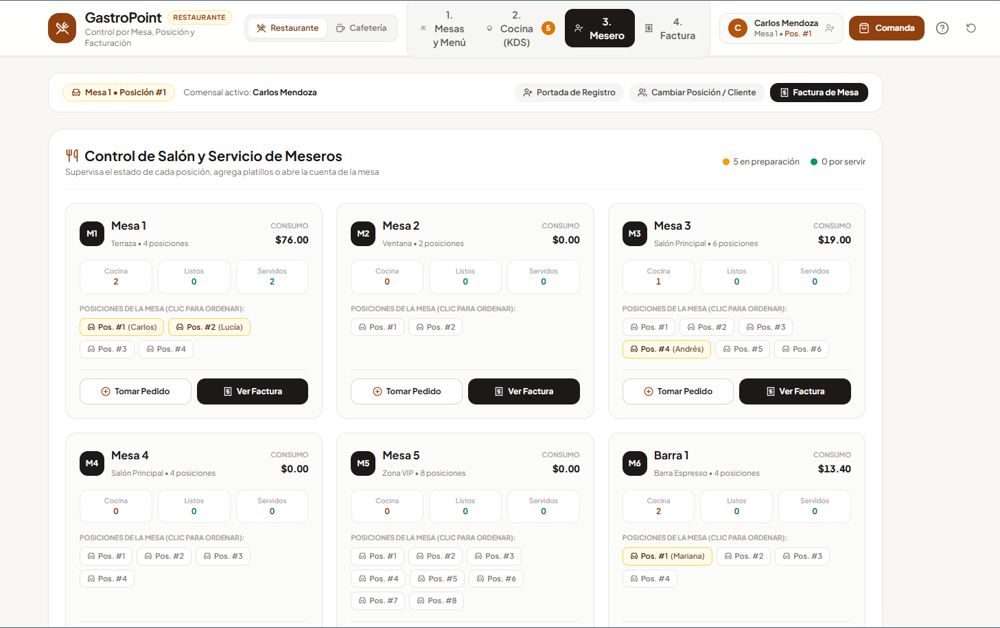 |
| *Tablero KDS en vivo indicando Mesa, Posición exacta, cliente, notas y estado de cocción.* | *Supervisión de mesas activas, platillos en cocina/listos/servidos y consumo acumulado.* |

<div align="center">

### Módulo de Facturación Inteligente: Unificar Todo, Por Posición, Unir Asientos o Partes Iguales
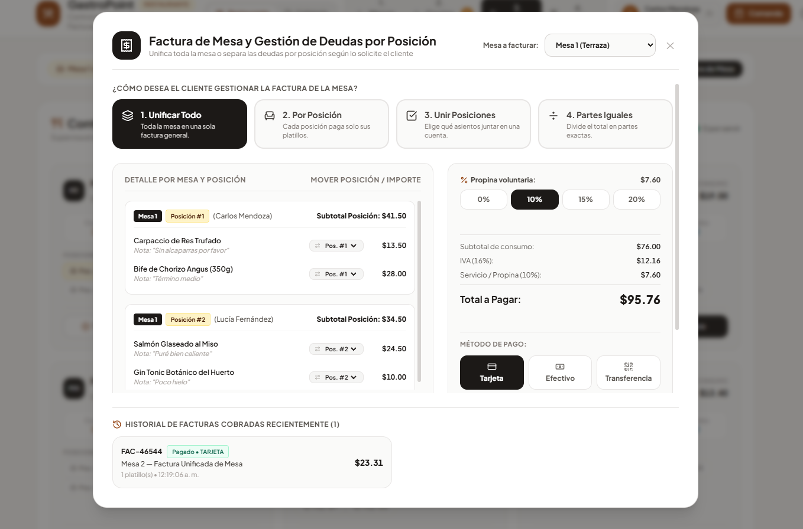
<p><i>Gestor de cobro con 4 modos de división de cuenta, reasignación de platillos entre posiciones, cálculo automático de IVA (16%) y propina (0%, 10%, 15%, 20%), pago con tarjeta/efectivo/transferencia e historial de facturas cobradas.</i></p>

</div>

---

## Módulos Interactivos con IA Incluidos en Mi Portafolio ([AllanSoto/Porfolio](https://github.com/AllanSoto/Porfolio))

Además de la galería de proyectos con video y capturas, el repositorio de mi portafolio ([`AllanSoto/Porfolio`](https://github.com/AllanSoto/Porfolio)) incluye un backend en **Node.js + Express (`server.ts`)** conectado al SDK oficial **`@google/genai` (Google Gemini)** que potencia 3 herramientas en vivo:

1. **Analizador de Alcance y Propuestas Técnicas (`/api/scope-analyzer`)**:
   - Recibe la descripción del problema de negocio del cliente, la categoría de servicio y el nivel de urgencia, generando automáticamente una propuesta estructurada con arquitectura paso a paso, stack recomendado, tiempo estimado y mensaje listo para Fiverr o WhatsApp.
2. **Asistente y Optimizador SQL Avanzado (`/api/sql-assistant`)**:
   - Genera y optimiza consultas complejas en **SQL Server (T-SQL)** y **MySQL** utilizando `CTEs`, `Window Functions`, `Stored Procedures` y `MERGE`, entregando recomendaciones de indexación y vista previa de resultados.
3. **Simulador de Auditoría de Ciberseguridad e Infraestructura (`/api/security-audit`)**:
   - Audita la pila tecnológica de una aplicación web y emite un puntaje de seguridad junto con cabeceras HTTP críticas (`HSTS`, `CSP`, `X-Frame-Options`, `X-Content-Type-Options`) y pasos de hardening según **ISO 27001** y **OWASP**.

---

<div align="center">

## Contacto Profesional

**Allan Soto - Senior Software Developer, Data Engineer & AI Media Specialist**  
Costa Rica (`+506 7100-6253`) | Servicio Global

[](https://wa.me/50671006253)
[](https://www.fiverr.com/s/BRqvjqy)
[](https://www.linkedin.com/in/allan-soto-b83850271)

</div>
